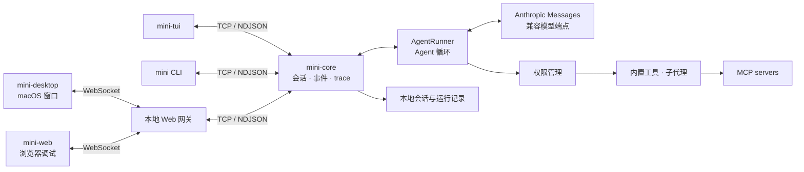

# MiniClaude

**本地优先的 AI Agent 工作台与运行时。**

在终端或 macOS 桌面中处理项目任务，实时查看模型输出、工具执行和权限审批，并在重启后继续已有会话。
常驻的 `mini-core` 统一管理会话、模型与工具；TUI、桌面和调试客户端共用同一套事件协议。

[](https://www.python.org/)
[](https://docs.astral.sh/uv/)
[](https://github.com/zmylol/MiniClaude/releases/tag/v2.0.0-beta.1)
[](./LICENSE)

[快速开始](#快速开始) · [核心能力](#核心能力) · [架构](#architecture) · [配置](#配置与本地数据) · [开发](#开发与验证) · [路线图](#roadmap-preview) · [文档](#文档地图)

> 当前测试版：**2.0.0 Beta 1**（Python 包版本 `2.0.0b1`）。接口与行为仍在迭代。
> 版本变化、升级说明和验证记录见 [CHANGELOG.md](./CHANGELOG.md)。

## 快速开始

基础运行环境为 **macOS / Linux、Python 3.12.x 和 [uv](https://docs.astral.sh/uv/)**。
`uv` 可以自动管理所需的 Python。macOS 桌面窗口需要额外安装 `desktop` 依赖。

### 1. 安装

```bash
git clone https://github.com/zmylol/MiniClaude.git
cd MiniClaude
uv sync
cp .env.example .env
```

<details>
<summary>尚未安装 uv？</summary>

```bash
curl -LsSf https://astral.sh/uv/install.sh | sh
```

安装后重新打开终端，再执行上面的安装命令。

</details>

### 2. 配置模型

编辑项目根目录的 `.env`，填入 Anthropic API key：

```dotenv
ANTHROPIC_API_KEY=sk-ant-...
MINI_LLM_DEFAULT_MODEL=claude-sonnet-4-6
```

只检查 Core 连通性时无需模型密钥；发送聊天消息或执行 Agent 任务时需要有效的模型配置。

<details>
<summary>使用 DeepSeek 或其他 Anthropic Messages 兼容端点</summary>

模型接入使用 Anthropic Messages 协议。以 DeepSeek 官方兼容端点为例：

```dotenv
ANTHROPIC_BASE_URL=https://api.deepseek.com/anthropic
ANTHROPIC_API_KEY=你的-DeepSeek-API-key
MINI_LLM_DEFAULT_MODEL=该端点提供的模型-ID
```

将密钥和模型 ID 替换为实际值。切换服务时同时更新地址、密钥和模型；其他服务需要提供
Anthropic Messages 兼容接口。官方 DeepSeek 端点的原生搜索行为见 [联网能力](docs/NETWORKING.md)。

</details>

### 3. 启动并开始对话

```bash
uv run mini core start
uv run mini ping
uv run mini-tui
```

`mini ping` 返回 `pong server=2.0.0b1 ...` 表示客户端已连接 Core。
TUI 中可以直接输入：

```text
阅读这个项目的 README 和目录结构，说明各模块的职责，并给出建议的阅读顺序。
```

界面会实时显示回复、工具调用与审批请求。需要在终端执行一次性任务时：

```bash
uv run mini run --goal "总结 README.md 的主要章节"
```

查看或停止后台 Core：

```bash
uv run mini core status
uv run mini core stop
```

更新代码或修改模型连接配置后，重启 Core 使改动生效。

### 使用 macOS 桌面应用

完成安装和模型配置后，也可以直接打开独立桌面窗口；应用会连接或启动对应项目的 Core。

```bash
uv sync --extra desktop
uv run --extra desktop mini-desktop
```

桌面支持项目切换、历史续聊、文件和图片附件、审批与停止，以及 Git 改动、PR 列表、
计划任务和 MCP 服务管理。详细操作见 [桌面应用说明](docs/DESKTOP.md)。

<details>
<summary>生成本机 .app 启动入口</summary>

```bash
.venv/bin/python scripts/build_macos_app.py
```

随后打开 `dist/MiniClaude.app`。这是依赖当前项目和 `.venv` 的本机启动器，尚非独立安装包。

</details>

## 核心能力

### 一个 Core，多种入口

`mini-core` 常驻本机，统一管理会话、运行状态、工具与权限。TUI 和桌面用于交互，
CLI 用于脚本化验证与调试；浏览器入口方便调试 Web 界面。

| 入口 | 适用场景 |
| --- | --- |
| `mini-tui` | 终端多轮对话、流式输出、工具展示、权限审批与历史回放 |
| `mini-desktop` | macOS 项目工作台、会话管理、附件、改动查看与 MCP 管理 |
| `mini` | 连通性检查、一次性任务、CLI 聊天与 trace 查询 |
| `mini-web` | 浏览器调试入口，默认地址为 `http://127.0.0.1:7438` |

### 看得见执行过程，也能介入

模型 token、运行步骤、工具结果、审批和上下文压缩通过事件流实时更新。
权限管理支持按次或持久化决策；桌面提供只读、按需审批和完全访问模式，
并可停止正在执行的任务。主代理与子代理使用相同的会话权限。

Trace 记录 IPC、事件和 LLM 层数据，便于定位失败、检查工具调用与回放历史运行。

### 从文件操作到联网与工具扩展

| 能力 | 当前实现 |
| --- | --- |
| 文件与命令 | `read_file`、`write_file`、`list_dir`、`bash` |
| 任务与委派 | task 系列工具、子代理角色与编排 |
| Skills | 加载技能说明，复用初始化、审查、总结等工作流程 |
| 搜索 | 官方 DeepSeek Anthropic 端点使用原生服务端搜索，其他后端使用 DDGS |
| 网页正文 | Trafilatura 提取正文、链接与元数据 |
| 浏览器 | 通过 Playwright MCP 操作按任务隔离的浏览器 |
| MCP 扩展 | 支持 stdio / TCP 服务，将发现的工具注册到 Agent |

搜索和正文抓取随基础依赖安装；**只有浏览器工具额外需要 Node.js 20+、`npx` 和 Chrome**。
配置、代理和浏览器登录态的范围见 [联网能力](docs/NETWORKING.md)。

### 独立工具并发执行

同一轮的多个工具调用默认并发调度，结果仍按调用顺序回传。
每个调用独立进行权限检查与超时处理，并按工具策略决定是否重试；停止任务会取消未完成的调用并保留已完成结果。

适合并行的是互不依赖的工作。依赖前一个结果或修改同一资源的操作需要分轮发起；
同步文件 I/O 仍在事件循环中执行，同一 MCP 连接通过请求锁串行调用。

<details>
<summary>验证并行工具：三个独立的 3 秒任务</summary>

更新代码后先重启 Core，再在聊天界面发送：

```text
请在下一轮同时发出 3 个独立的 bash 工具调用，分别执行下面的一条命令。
不要合并命令，不要使用 &、后台子代理，也不要先运行探测命令。

python3 -c 'import time; s=time.time(); time.sleep(3); print("A", s, time.time())'
python3 -c 'import time; s=time.time(); time.sleep(3); print("B", s, time.time())'
python3 -c 'import time; s=time.time(); time.sleep(3); print("C", s, time.time())'

收到全部结果后，列出 A/B/C 的开始与结束时间，检查最晚开始时间是否早于
最早结束时间，并计算从最早开始到最晚结束的总耗时。根据实际输出判断是否并行。
```

如出现审批，请及时批准三个调用。执行区间重叠时总耗时约 3 秒，串行时约 9 秒；
模型输出和人工审批的等待时间会影响聊天总耗时。

</details>

### 会话与上下文留在本机

会话历史按项目保存，桌面重启后可继续已有对话。
全局 `~/.mini/context.md`、项目 `.mini/context.md` 与 session notes 为后续轮次提供上下文；
长对话支持压缩，TUI 中可用 `/compact` 手动触发。

目前提供的是上下文文件、笔记和摘要。带原始证据引用的 Memory v1 位于[后续路线图](#roadmap-preview)。

## Architecture



1. Core 加载配置，初始化会话、权限、MCP 连接与事件记录。
2. 客户端通过 JSON-RPC 2.0 发送命令并订阅事件；CLI/TUI 直接连接 TCP loopback，桌面/Web 经本地网关转发。
3. `SessionManager` 将消息交给 `AgentRunner`，组合模型、工具与执行上下文。
4. 工具调用按权限策略执行，需要审批时等待用户决策；运行事件持续返回界面并写入本地记录。

源码入口：[`core/`](src/mini_claude/core/) · [`tui/`](src/mini_claude/tui/) ·
[`desktop/`](src/mini_claude/desktop/) · [`web/`](src/mini_claude/web/) · [`cli/`](src/mini_claude/cli/)。

协议模型位于 [`core/bus/`](src/mini_claude/core/bus/)；
[WIRE_PROTOCOL.md](./WIRE_PROTOCOL.md) 由模型生成，自定义客户端可据此接入。

## 常用命令

聊天、任务、TUI 回放与浏览器调试需要 Core 已启动；trace 命令直接读取本地日志。

| 命令 | 用途 |
| --- | --- |
| `uv run mini chat` | CLI 多轮聊天 |
| `uv run mini run --goal "..."` | 执行一次性任务 |
| `uv run mini-tui --replay <run-id>` | 回放历史运行事件 |
| `uv run mini trace` | 查看 trace |
| `uv run mini trace <run-id>` | 按运行 ID 过滤 |
| `uv run mini trace --layer llm` | 只查看 LLM 层 trace |
| `uv run mini trace --raw --follow` | 持续跟踪 NDJSON trace |
| `uv run mini-web` | 打开浏览器调试服务 |

`uv run mini --version` 查看包版本；`uv run mini-core` 在前台启动 Core，适合观察日志。

## 配置与本地数据

默认配置优先级从低到高：

```text
内建默认值 → ~/.mini/config.toml → .mini/config.toml → .env → 系统环境变量
```

设置 `MINI_CONFIG` 时，指定文件替代默认的全局与项目 TOML 配置；`.env` 和系统环境变量仍有更高优先级。
模型连接示例见[快速开始](#2-配置模型)，完整环境模板见 [`.env.example`](.env.example)。

| 变量 | 默认值 | 用途 |
| --- | --- | --- |
| `MINI_HOST` / `MINI_PORT` | `127.0.0.1` / `7437` | Core 监听地址与端口 |
| `MINI_LLM_DEFAULT_MODEL` | `claude-sonnet-4-6` | 默认模型 |
| `MINI_MAX_STEPS` | `20` | 单次运行最大步数 |
| `MINI_PERMISSION_TIMEOUT_S` | `60` | 审批超时秒数，`0` 表示不超时 |
| `MINI_COMPACT_THRESHOLD` | `0` | 自动压缩阈值，`0` 表示禁用 |
| `MINI_LOG_LEVEL` / `MINI_LOG_FORMAT` | `INFO` / `text` | 日志级别与格式，格式也支持 `json` |
| `MINI_LOG_FILE` | `~/.mini/logs/core.log` | Core 日志路径 |
| `MINI_TRACE_ENABLED` | `true` | 是否启用 trace |
| `MINI_TRACE_FILE` | `~/.mini/traces/daemon.jsonl` | Trace 路径 |

<details>
<summary>本地数据位置</summary>

| 路径 | 内容 |
| --- | --- |
| `~/.mini/sessions/` | 会话、运行事件、笔记与摘要 |
| `~/.mini/context.md` / `.mini/context.md` | 全局 / 项目上下文 |
| `~/.mini/policy.toml` | 持久化权限策略 |
| `~/.mini/logs/core.log` / `~/.mini/logs/tui.log` | Core / TUI 日志 |
| `~/.mini/traces/daemon.jsonl` | IPC、事件与 LLM trace |
| `~/.mini/desktop/` | 桌面偏好与默认工作区 |
| `.mini/desktop_schedules.json` | 当前项目的计划任务 |
| `.mini/desktop_mcp.json` | 桌面管理的 MCP 配置 |

</details>

日常操作与排错见 [RUNBOOK.md](./RUNBOOK.md)。

## 开发与验证

项目采用 `src/` 布局、Hatchling 构建，以及 Ruff、mypy、pytest 工具链。

```bash
uv sync
uv run ruff check src tests scripts
uv run mypy src
uv run pytest tests/unit -v
uv run pytest tests/integration -k ping -v
```

单元测试与 ping 集成测试无需模型密钥；集成测试夹具会自行启动 Core。
完整集成测试中的真实模型用例需要 API key。Web 前端单元测试可用 Node.js 执行：

```bash
node --test tests/web/*.test.mjs
```

改动协议模型后重新生成文档，并检查是否与代码一致：

```bash
uv run python scripts/gen_protocol_doc.py
uv run python scripts/gen_protocol_doc.py --check
```

`make docs` 可生成协议文档；`make verify-s0` 汇总依赖、lint、类型、单元测试、ping 与协议检查。
已有验证记录及已知检查问题见 [CHANGELOG.md](./CHANGELOG.md)。贡献前请阅读 [AGENT.md](./AGENT.md)。

## Roadmap Preview

| 方向 | 状态 | 下一步 |
| --- | --- | --- |
| S8 · Desktop & Parallel Tools | 已完成 | 维护桌面工作台、会话恢复与同轮工具并行 |
| S9 · Graph Runtime | 下一主线 | 静态串行任务图，再推进受控并发 |
| Memory v1 · 证据记忆支撑线 | 计划中 | 显式保存决策、原始证据与预算化检索 |
| S10 · Critical Decisions | 后续计划 | 单候选验证，再按评测决定是否引入双候选、Critic 与 Recovery |
| S11 · Bounded Exploration | 实验方向 | 固定预算的只读候选探索，动态 Local GraphLoop 后置 |

S8–S11 是内部能力里程碑，不对应包版本或承诺发布日期。
完整范围、非目标和评测门槛见 [ROADMAP.md](./ROADMAP.md)；
[压缩后约束恢复实验](experiments/constraint_memory/README.md)独立于产品运行时。

当前使用边界：桌面 `.app` 依赖本机 checkout，计划任务仅在应用打开期间执行；
PR 页面提供读取与跳转。详细范围见 [桌面应用说明](docs/DESKTOP.md)。

## 文档地图

| 文档 | 内容 |
| --- | --- |
| [桌面应用](docs/DESKTOP.md) | 项目、会话、附件、计划任务与 MCP 管理 |
| [联网能力](docs/NETWORKING.md) | 搜索、网页提取、浏览器、代理与限制 |
| [运行手册](./RUNBOOK.md) | 配置、日志与故障排查 |
| [协议参考](./WIRE_PROTOCOL.md) | 自动生成的 JSON-RPC 命令与事件契约 |
| [路线图](./ROADMAP.md) | S8–S11 的范围、交付顺序与评测门槛 |
| [更新日志](./CHANGELOG.md) | 版本变化、升级说明与验证记录 |
| [版本发布](docs/RELEASING.md) | 版本约定与发布步骤 |
| [AGENT.md](./AGENT.md) / [CLAUDE.md](./CLAUDE.md) | 仓库开发与协作约定 |

## 许可

MiniClaude 使用 [MIT License](./LICENSE)。
